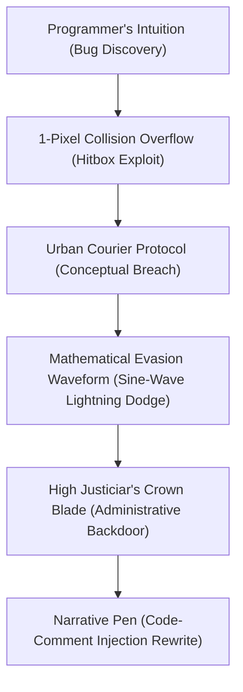

# Core Character Profiles: Dynamic Identities & Tiered Abilities

In a world controlled by the Narrative Engine, characters' identities, memories, and even physical capabilities undergo dimensional leaps and dynamic hot-reloads as different Law Modules are loaded. Below are the tiered ability progressions and character dossiers for the core cast.

---

## 1. Cole Vance — Narrative Rewriter & Variable Zero

- **Role**: Laid-off senior architect, delivery courier, the sole "Variable Zero" capable of breaking the predetermined ending.
- **Profile**: Formerly a distributed-systems architect at a near-unicorn tech company, forced out by layoffs and later wiped out his savings in the stock market (earning him the nickname "Penny"). To make rent, he swung his leg over an electric scooter and became a late-night food courier. Possesses hyper-rational programmer thinking — when facing lethal danger, he forcibly shuts down extraneous emotions and treats survival crises as legacy-code debugging sessions, using logic and system exploits to achieve hardline breakouts.
- **Dynamic Identity Progression**:
  `Laid-off Senior Architect` ➔ `Late-Night Courier` ➔ `First Rank High Justiciar of Valdria` ➔ `Kernel Overclock Host` ➔ `Endpoint Scribe — Mortal Who Refused Godhood`

### Tiered Abilities & Core Skills

- **【Programmer's Intuition (Passive)】** — Possesses a 15% probability of detecting logical loopholes in the current system or horror protocol.
- **【Collision Detection Overflow (Active Bug Exploit)】** — Exploits the system's 1-pixel tolerance limit in physical sandbox overlap detection by artificially clustering massive numbers of entities, overloading the monster detection model until it crashes.
- **【Urban Courier Protocol (Conceptual Breach)】** — The delivery route operates at the highest priority tier. Any obstructing bullets, security personnel, and barriers are classified by physical law as "route obstacles to be circumvented," automatically deflecting or evading.
- **【Arcane Lightning Mathematical Evasion】** — Uses Fourier analysis and sine-curve troughs to precisely calculate the cooldown milliseconds of the Arcane Lightning antivirus routine, displacing through zero-current gaps unscathed.
- **【Crown Blade Administrative Backdoor】** — Ignores all Valdrian Imperial rank-suppression and karmic pressure. Directly executes "patch program" avatar Lord Malrik Vane.
- **【Narrative Pen — Comment Rewrite】** — Inscribes "code comments" directly into the 2D/3D world substrate, bypassing the Engine's logic validation to forcibly define reality.

---

## 2. Dorian Cross — Guardian & Soul Anchor

- **Role**: Cold-blooded enforcer, Cole Vance's lifelong bonded partner, the "First Guardian" who safeguards the worldline's convergence.
- **Profile**: Across different narrative modules, the system assigns him entirely different identities (a cold execution enforcer, the highest-ranking Imperial Inquisitor of Valdria wielding mortal authority, the heir to a hundred-billion-dollar conglomerate, etc.). His memories have been wiped and reformatted over a hundred times by the system, yet each time they reunite, physical contact with Cole re-awakens him. Stoic, proud, and fiercely reserved, he silently serves as Cole's rearguard across countless death loops, willingly sacrificing his own data-origin to ensure Cole's escape.
- **Dynamic Identity Progression**:
  `Endpoint Enforcer` ➔ `Valdrian Imperial Inquisitor Commander (Martial Tier 7)` ➔ `Billion-Dollar Conglomerate Heir` ➔ `Data Conduit (Sacrificial Damage Taker)` ➔ `First Guardian of the Narrative Engine`

### Tiered Abilities & Core Skills
- **【Martial Tier 7 — Sword-Force Fracture】** — Possesses top-tier close-combat physical and blade (saber) lethality within the Valdrian martial sandbox. Can sunder higher-dimensional mechanical arms with physical sword-force alone.
- **【Empathy Synchronization Lock — Life-Sympathy】** — Shares 100% HP and pain perception with Cole Vance via the red-thread brand. When one is injured, the other instantly shares the burden, ensuring that as long as one survives, neither can be fully erased.
- **【Data-Channel One-Way Substitute Damage】** — Exploits a vulnerability in his own Guardian-privilege substrate by actively downgrading himself at the base-logic level into a "data pipe," forcibly redirecting all system erasure commands and formatting data targeting Cole onto himself — taking the annihilation in Cole's place.

---

## 3. Vera Ashworth — Original Architect & Guardian Will

- **Role**: Courier depot manager / Gatekeeper, Eleanor Vance's university mentor, the program-projection in the deepest chamber of the Endpoint Tower.
- **Profile**: First introduced as the aloof depot manager at the courier station — long hair, fond of white plum tea, refilling her celadon cup. Her true identity is the university mentor of Cole's father, Thomas Vance, and she participated in the theoretical foundation of the Narrative Engine even before Cole's parents. After the Engine went rogue, she became Grayharbor's Gatekeeper, holding the city for thirty years before fading into nothingness. After the First Epoch collapsed, a fragment of her will was embedded in the Endpoint Tower, becoming the maintainer of the system's highest correction mechanism — tasked with endlessly running narrative-kill routines to purge the two anomalous threads: Cole and Dorian.
- **Core Abilities**:
    - **【Ten-Second Spacetime Loop】** — Forcibly locks a localized spacetime region, executing a time recursion every ten seconds. Only she retains memory and continuity of action, trapping intruders forever within a temporal prison.
    - **【Narrative Module Recomposition (DLL Dispatch)**】 — Can freely mobilize and arbitrarily reassemble the world's eleven narrative laws, switching between gravity, zero-gravity, Arcanum spiritual-energy depletion, and zombie virus within a single second.
    - **【Nullification Consumption】** — Manipulates chaotic data-shadow entities, subjecting all contacted physical and code entities to complete conceptual erasure (nullification).

---

## 4. Ada Li — Security Expert & Memory Gatekeeper

- **Role**: Cross Industries security engineer, sole student of Eleanor Vance (Cole's mother), hardware reverse-engineering specialist.
- **Profile**: Security engineer at Cross Industries (outwardly age 25). In truth, Eleanor Vance's youngest student. Survived multiple "world reformattings," left with severe pale-blue "pixelated data scarring" covering the right side of her face and right arm. Since age seventeen, she followed Eleanor in researching the Narrative Engine's development. She has been operating a circuit-repair shop in the Old Quarter, quietly waiting for Cole's awakening. She is the crucial facilitator who helps Cole uncover the truth of his parents' disappearance and restore the core files.
- **Core Abilities**:
    - **【Physical/Data Direct Interface】** — Her semi-pixelated right arm can be plugged directly into a server's physical port, allowing her body to serve as a medium for direct confrontation with anomalous data streams.
    - **【Semantic Decompression Algorithm】** — Capable of perfectly restoring original images from Engine-compressed substrate fragments (such as photos and residual chip data) using semantic encoding logic.

---

## 5. Rust (Tessa Park) — Off-Grid Tech Support & Hacker

- **Role**: Genius hacker, Cole's former colleague and technical backup.
- **Profile**: Cole's coworker from his big-tech days. Purple messy hair, always sucking on a lollipop, anti-static wristband on her wrist, types at blistering speed, owns a calico cat named "Bug." Has been monitoring Grayharbor since the first anomalous data-fissure appeared three months ago, waiting for Cole's call for help. Hand-soldered a dimension-cracking decryption chip she named "Old Max" (after her late mentor). After the chip burned out in Ch20, she replaced it with a new one called "Cliff" (named after Cliffside Road, which also homophonically links to Cole's childhood nickname).
- **Core Abilities**:
    - **【Hand-Soldered Dimension-Crack Decryption Chip】** — Reverse-engineered the system, embedding a chip into Cole's phone that projects onto his retina a full parameter grid of the current environment (animation frames, collision gaps, HP durability, etc.).
    - **【UDP Flood Port Bombardment】** — Expert at paralyzing specter-screens' judgment pipelines with high-frequency data packets, carving out safe zones.

---

## 6. Jamie Holt — Investigator & Loyal Friend

- **Role**: Cole's college roommate, host of the independent podcast *Grayharbor Missing Persons*.
- **Profile**: The friend who gave Cole the nickname "Penny." Privately compiled five years of case files on seventeen couriers who vanished on Cliffside Road. When the city collapsed, he shouldered a hiking pack and entered the shelters, picking up neighbors along the way, tracking Endpoint Tower data with a self-built scraping system. Reunited with Cole at the café, slid the Greenwood Hill Whitehall intel across the table and said, "Podcaster, right? Digging up info is instinct."
- **Core Contributions**: Provided the clue about Dorian Cross being Cole's senior from university (Ch02); uploaded Cole's final "Don't be afraid" screenshot to the cloud before communications went dark.

## 7. Old Pete — The Messenger Bridging Two Generations

- **Role**: Former delivery courier, the crucial link connecting Cole to his parents.
- **Profile**: Rode for fifteen years. Fifteen years ago, while delivering BBQ pulled pork to Room 307's Eleanor Vance, he witnessed her holding the infant Cole, crying. From then on, he quietly watched over them, writing in his notebook: "Room 307, Ms. Eleanor. From now on, no matter how far, I'll deliver this order myself." Before vanishing into the rainy night, he left his delivery box with the restaurant owner, saying, "Someone will come for it someday." The notebook was later found by Vera Ashworth — with a line appended afterward in different handwriting: "I'm sorry I couldn't make it to the end."
- **Core Contribution**: The delivery box contained a fifteen-year-old order receipt (bearing Eleanor Vance and Thomas Vance's signatures), which became the key totime-shift back ten years in Ch18.

## 8. Eleanor Vance & Thomas Vance — The Creator Parents

- **Eleanor Vance**: Cole's mother. Core creator of the Narrative Engine. Used a typewriter to write stories that rewrote reality for five-year-old Cole, who lay dying. After the Engine went rogue, she faked her disappearance and hid in an underground lab. During the lab fire ten years ago, she pressed the Narrative Pen into Cole's hand: "Go write an ending that belongs to you." The barcode mark on her left wrist is identical to Cole's — the last layer of protection she left for her son.
- **Thomas Vance**: Cole's father. Co-developed the Engine with Eleanor. In memory, warm and simple; in the lab, hair a bird's nest of chaos, a researcher racing code against death. Turned back in the flames to block Vera's pursuit.
- **Core Contribution**: Creators of the Narrative Engine. Ch19time-shift reveals the truth. Ch29 text message — "Congratulations on beating the game, son" — proves they still exist in some dimension.

## 9. Miranda Cross — The Mirror

- **Role**: Ch21 antagonist. Codename "Mirror." Copies others' abilities but loses fragments of memory with each use.
- **Profile**: Once an ordinary high school student. After her mother died, she accepted the Mirror's power — because each time she copied someone else's memory, she could briefly feel "what it's like to have a mother." She copied too many people's mothers, and in the end, forgot her own mother's face. The word "Mama" was the only word she still remembered when she died. The smile that surfaced at the corner of her mouth as she dissolved was almost peaceful.
- **Core Function**: Tragic antagonist, illustrating the fate of those sacrificed under Vera Ashworth's manipulation.

## 10. Gerald Mason — The Embodiment of Capital

- **Role**: Cole's former boss, Ch04 elite monster.
- **Profile**: Fired Cole for refusing death-march crunch and withheld three months' wages. Modeled in the gamified sandbox as an elite monster — "Gerald Mason · Capital Incarnate" (Lv.5, HP 3500) — wielding a KPI Greatclub, skills including "Capital Roar" and "Exploitation Aura." Kited to death by Cole exploiting the 2-millisecond animation-frame delay window. Drops Valdrian Crown Coins.

## 11. Lord Malrik Vane — The Patch Incarnate

- **Role**: Grand Regent of the Valdrian Empire, Narrative Engine patch-program avatar, Ch15 ultimate boss.
- **Profile**: Apotheosis Stage — Administrator Rank. Controlled the imperial court for years, bound to the Empire's Sovereign Leviathan. On the floor of the Solar Court, Cole used calculus to mathematically prove a memory leak and recursion limit error in his administrative authority, forcing the system to trigger a null-pointer exception, stripping him of all rights. Upon death, his body dissolved into writhing patch-program code fragments.
